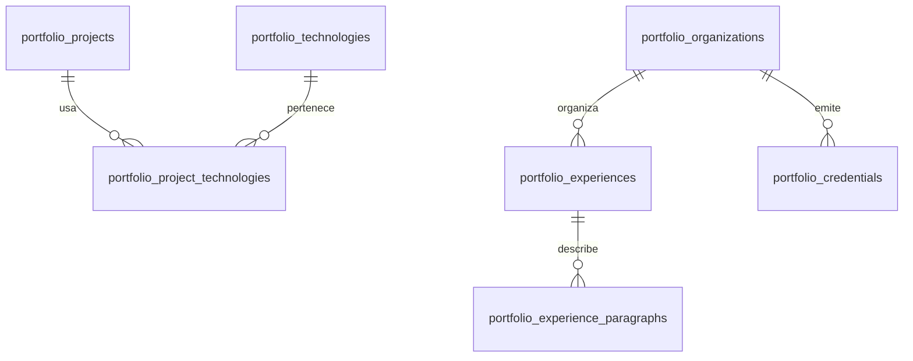

# Contenido relacional del portfolio

Proyecto previsto: `https://iwllvbwevpflsbtquhiz.supabase.co`.

## Estado remoto

La implementación y sus pruebas locales están preparadas, pero no se ha confirmado ni aplicado en el proyecto remoto. En esta sesión de VS Code Copilot no estuvo disponible el MCP de Supabase configurado en Codex: el comando `codex` no está instalado y el cliente de base de datos genérico devolvió `Connection not found` (no es una conexión a este proyecto). Por ello no se pudieron inspeccionar las tablas, ejecutar la migración, obtener la publishable key, correr los advisors ni verificar la API o el portfolio conectado a datos reales.

`publishableKey` en `assets/js/portfolio-config.js` permanece intencionalmente vacío. No se debe ejecutar la migración hasta inspeccionar el proyecto con una conexión autorizada y revisar cualquier tabla `portfolio_*` existente. No se hizo ningún cambio remoto.

## Tablas

- `portfolio_projects`: título, descripción, categoría, imagen, enlace y estado.
- `portfolio_technologies`: catálogo de tecnologías.
- `portfolio_project_technologies`: relación entre proyectos y tecnologías; permite ordenar las etiquetas.
- `portfolio_experiences`: empresa/institución, puesto, período, ubicación y sector.
- `portfolio_experience_paragraphs`: párrafos ordenados de cada experiencia.
- `portfolio_credentials`: formación y certificaciones, diferenciadas por `kind`.
- `portfolio_organizations`: empresas e instituciones compartidas por experiencia y formación.

Los campos `_es` y `_en` permiten editar ambos idiomas. Si `_en` queda vacío, se muestra el texto español. Los períodos actuales se conservan como texto; `start_date`, `end_date` e `issued_on` son opcionales y no se inventaron fechas para las tarjetas originales.

## Conectar el proyecto

1. Abrir una sesión que tenga disponible el MCP de Supabase de Codex, configurado para `iwllvbwevpflsbtquhiz`, o acceder al dashboard con una cuenta autorizada. No confundirlo con una conexión genérica de base de datos: esta sesión no tiene una conexión configurada.
2. Inspeccionar las tablas existentes antes de aplicar `supabase/migrations/20261027002058_portfolio_content.sql`. La migración crea exclusivamente tablas `portfolio_*` y carga los 3 proyectos, 3 experiencias y 5 credenciales actuales. Si ya existen tablas con esos nombres, revisar conflictos y detenerse antes de ejecutar; no sobrescribir datos ajenos.
3. Aplicar la migración solo después de comprobar que es segura, con el MCP autorizado o pegando su contenido completo en **SQL Editor → New query → Run**. Ejecutarla una sola vez. El archivo es transaccional.
4. Ejecutar `database/verify.sql` y revisar los avisos de seguridad en Supabase.
5. Copiar la **publishable key** pública (`sb_publishable_…`) de **Settings → API Keys** a `publishableKey` en `assets/js/portfolio-config.js`. Nunca usar `service_role`, una secret key ni la contraseña de PostgreSQL.
6. Ejecutar los advisors de Supabase y verificar la API con esa clave antes de publicar: los GET a `/rest/v1/portfolio_projects`, `/rest/v1/portfolio_experiences` y `/rest/v1/portfolio_credentials` deben devolver solamente filas publicadas. Comprobar también las relaciones y que no existan permisos de escritura pública.
7. Con el esquema y los permisos confirmados, probar la página conectada y el refresco tras agregar o editar una fila publicada. Luego publicar los archivos. No hace falta cambiar HTML ni redesplegar por cada tarjeta; no se utiliza una suscripción Realtime.

Las tablas tienen RLS y permisos explícitos de **solo lectura** para visitantes y usuarios autenticados. Los borradores (`published = false`) y sus detalles no son públicos. Las modificaciones se hacen desde el panel de Supabase/SQL Editor con tu cuenta administradora. No hay un panel de administración público.

Si falta la clave o falla una consulta, esa sección conserva el HTML inicial. Si una consulta funciona pero no hay registros publicados, se muestra un mensaje vacío en lugar de resucitar tarjetas eliminadas. Las secciones se cargan independientemente, con paginación y orden estable por `sort_order, id`.

## Agregar proyectos

En **Table Editor → portfolio_projects → Insert row**, completar `slug` único, `title_es`, `description_es`, `category`, `sort_order` y `published`. `url` debe ser HTTPS; sin URL la tarjeta se presenta como artículo y puede mostrar `status_es` («En desarrollo», por ejemplo).

`image_path` puede ser una ruta `assets/images/archivo.png` existente en el repositorio o una URL HTTPS pública de una imagen. Completar el texto alternativo en `image_alt_es` / `_en`. `image_fill = true` llena la cubierta, como en Kiosco; `false` conserva el encuadre de Seeki. Si no se indica imagen, se usa la cubierta con el asterisco existente.

Registrar las tecnologías nuevas en `portfolio_technologies` y asociarlas con el proyecto en `portfolio_project_technologies`, usando `project_id`, `technology_id` y `sort_order`. Un mismo registro de tecnología puede usarse en varios proyectos.

El carrusel se adapta a la cantidad de proyectos, muestra hasta tres tarjetas por vista de escritorio, dos en tablet y una en móvil. Admite flechas, teclado y deslizamiento táctil; no gira automáticamente.

## Agregar experiencia

Crear primero la empresa/institución en `portfolio_organizations` si aún no existe. Luego agregar `portfolio_experiences`, elegir `organization_id` y completar los textos. `label_es` es opcional y permite conservar etiquetas como «GrantFox — Open Source» o «Becada»; no reemplaza el nombre real de la organización.

Agregar los párrafos en `portfolio_experience_paragraphs`, vinculados por `experience_id`. Usar `sort_order` para controlar el orden tanto de tarjetas como de párrafos. Poner el orden menor en las experiencias que se quieran mostrar primero.

Se muestran inicialmente tres experiencias. Si hay más, aparece «Ver toda la experiencia ↓»; al pulsarlo, se despliega el historial completo. «Ver menos ↑» vuelve a las tres primeras. Las tres tarjetas actuales conservan su contenido.

## Educación y certificaciones

Agregar filas en `portfolio_credentials` con `organization_id`, `kind` (`education` o `certification`), títulos, imagen, texto alternativo, URL pública de la credencial, `sort_order` y `published`. Ambas clases comparten el carrusel actual; no hay que duplicar ni editar sus tarjetas HTML.

## Verificación local

- `node --test tests/portfolio-model.test.mjs`: URLs seguras, idiomas, orden, paginación y fallos de API.
- `node --check assets/js/portfolio-content.js` y `git diff --check`.
- `database/verify.sql`: tablas, RLS, privilegios, relaciones y cantidades en PostgreSQL.
- Para probar la interfaz sin credenciales, el HTML inicial conserva las tarjetas actuales. Para comprobar crecimiento, crear tarjetas de prueba en un entorno de desarrollo y confirmar los tres carruseles, el despliegue de experiencia y ambos idiomas.

La migración fue validada localmente con un motor PostgreSQL (PGlite), incluidas lectura anónima y denegación de escritura/borradores. La verificación remota debe repetirse tras conectar la cuenta autorizada; la prueba local no confirma el despliegue en Supabase.

`database/portfolio-seed.json` es la copia inicial del contenido. `scripts/build-portfolio-sql.py` reconstruye la migración inicial desde ese archivo; no debe usarse para sobrescribir migraciones ya aplicadas. Los cambios posteriores se realizan en Supabase y, si modifican el esquema, mediante una nueva migración.
