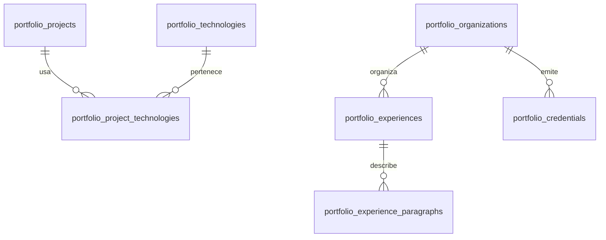

# Contenido relacional del portfolio

Proyecto activo: `https://iwllvbwevpflsbtquhiz.supabase.co`.

## Estado remoto

La migración `20261027024908_portfolio_content` fue aplicada al proyecto correcto después de comprobar que el esquema `public` y el historial de migraciones estaban vacíos. Las siete tablas tienen RLS. Se cargaron 3 proyectos, 3 experiencias, 5 credenciales, 6 párrafos de experiencia y 12 asociaciones de tecnologías.

La URL y la publishable key pública ya están configuradas. Las consultas REST reales y la interfaz en Chrome se verificaron con los datos de Supabase, en escritorio, móvil y español/inglés. La integración está en `feature/supabase-portfolio`; no se fusionó a `main` ni está publicada todavía en flor125.dev.

## Tablas

- `portfolio_projects`: título, descripción, categoría, imagen, enlace y estado.
- `portfolio_technologies`: catálogo de tecnologías.
- `portfolio_project_technologies`: relación entre proyectos y tecnologías; permite ordenar las etiquetas.
- `portfolio_experiences`: empresa/institución, puesto, período, ubicación y sector.
- `portfolio_experience_paragraphs`: párrafos ordenados de cada experiencia.
- `portfolio_credentials`: formación y certificaciones, diferenciadas por `kind`.
- `portfolio_organizations`: empresas e instituciones compartidas por experiencia y formación.

Los campos `_es` y `_en` permiten editar ambos idiomas. Si `_en` queda vacío, se muestra el texto español. Los períodos actuales se conservan como texto; `start_date`, `end_date` e `issued_on` son opcionales y no se inventaron fechas para las tarjetas originales.

## Conexión y mantenimiento

1. El MCP de Supabase está autorizado para `iwllvbwevpflsbtquhiz`. Verificar siempre la URL y las tablas antes de cambios posteriores.
2. La migración aplicada está versionada en `supabase/migrations/20261027024908_portfolio_content.sql`, con el mismo identificador que el historial remoto. No volver a ejecutarla ni editarla: para cambiar el esquema, crear una nueva migración.
3. `assets/js/portfolio-config.js` contiene solo la URL y la **publishable key** pública. Nunca utilizar `service_role`, una secret key ni la contraseña de PostgreSQL en el navegador.
4. Ejecutar `database/verify.sql` y `database/test-policies.sql` al revisar permisos. El segundo archivo crea datos temporales y revierte su transacción.
5. Las consultas REST devuelven únicamente contenido publicado y sus relaciones. El frontend marca los contenedores cargados correctamente con `data-content-source="database"` para distinguirlos del HTML de respaldo.
6. Agregar o modificar contenido desde Table Editor y recargar el portfolio conectado; no hace falta editar HTML ni redesplegar por cada tarjeta. No se utiliza Realtime.
7. Para publicar esta integración en flor125.dev, revisar y fusionar la rama de funcionalidad a `main`; esa publicación todavía está pendiente.

Las tablas tienen RLS y permisos explícitos de **solo lectura** para visitantes y usuarios autenticados. Los borradores (`published = false`) y sus detalles no son públicos. Las modificaciones se hacen desde el panel de Supabase/SQL Editor con tu cuenta administradora. No hay un panel de administración público.

Si falta la clave o falla una consulta, esa sección conserva el HTML inicial. Si una consulta funciona pero no hay registros publicados, se muestra un mensaje vacío en lugar de resucitar tarjetas eliminadas. Las secciones se cargan independientemente, con paginación y orden estable por `sort_order, id`.

## Agregar proyectos

En **Table Editor → portfolio_projects → Insert row**, completar `slug` único, `title_es`, `description_es`, `category`, `sort_order` y `published`. `url` debe ser HTTPS; sin URL la tarjeta se presenta como artículo y puede mostrar `status_es` («En desarrollo», por ejemplo).

`image_path` puede ser una ruta `assets/images/archivo.png` existente en el repositorio o una URL HTTPS pública de una imagen. Completar el texto alternativo en `image_alt_es` / `_en`. `image_fill = true` llena la cubierta, como en Kiosco; `false` conserva el encuadre de Seeki. Si no se indica imagen, se usa la cubierta con el asterisco existente.

Registrar las tecnologías nuevas en `portfolio_technologies` y asociarlas con el proyecto en `portfolio_project_technologies`, usando `project_id`, `technology_id` y `sort_order`. Un mismo registro de tecnología puede usarse en varios proyectos.

El carrusel se adapta a la cantidad de proyectos, muestra hasta tres tarjetas por vista de escritorio, dos en tablet y una en móvil. Admite flechas, teclado y deslizamiento táctil; no gira automáticamente.

## Agregar experiencia

Crear primero la empresa/institución en `portfolio_organizations` si aún no existe. Luego agregar `portfolio_experiences`, elegir `organization_id` y completar los textos. `label_es` es opcional y permite conservar etiquetas como «GrantFox — Open Source» o «Becada»; no reemplaza el nombre real de la organización.

Agregar los párrafos en `portfolio_experience_paragraphs`, vinculados por `experience_id`. Usar `sort_order` para controlar el orden tanto de tarjetas como de párrafos. Poner el orden menor en las experiencias que se quieran mostrar primero.

Se muestran inicialmente tres experiencias. Si hay más, aparece «Ver toda la experiencia ↓»; al pulsarlo, se despliega el historial completo. «Ver menos ↑» vuelve a las tres primeras. Las tres tarjetas actuales conservan su contenido.

## Educación y certificaciones

Agregar filas en `portfolio_credentials` con `organization_id`, `kind` (`education` o `certification`), títulos, imagen, texto alternativo, URL pública de la credencial, `sort_order` y `published`. Ambas clases comparten el carrusel actual; no hay que duplicar ni editar sus tarjetas HTML.

## Verificación local

- `node --test tests/portfolio-model.test.mjs`: URLs seguras, idiomas, orden, paginación y fallos de API.
- `node --check assets/js/portfolio-content.js` y `git diff --check`.
- `database/verify.sql`: tablas, RLS, privilegios, relaciones y cantidades en PostgreSQL.
- Para probar la interfaz sin credenciales, el HTML inicial conserva las tarjetas actuales. Para comprobar crecimiento, crear tarjetas de prueba en un entorno de desarrollo y confirmar los tres carruseles, el despliegue de experiencia y ambos idiomas.

La migración fue validada localmente con PostgreSQL/PGlite y aplicada a Supabase. `database/test-policies.sql` pasó en remoto: los borradores y sus párrafos/organizaciones quedan ocultos, sin permisos públicos de escritura. Se verificaron las cantidades 3/3/5 y RLS en las siete tablas. El advisor de seguridad no reportó hallazgos. El de rendimiento solo informó índices aún sin uso; se conservan porque la base es nueva.

`database/portfolio-seed.json` es la copia inicial del contenido. `scripts/build-portfolio-sql.py` reconstruye la migración inicial desde ese archivo; no debe usarse para sobrescribir migraciones ya aplicadas. Los cambios posteriores se realizan en Supabase y, si modifican el esquema, mediante una nueva migración.
